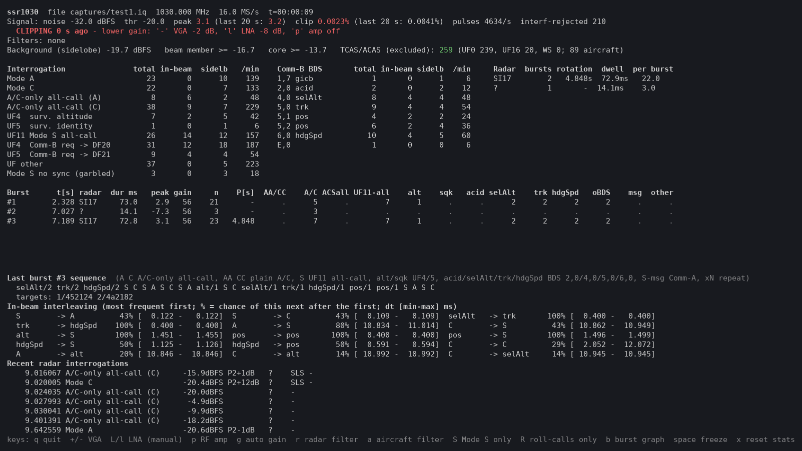
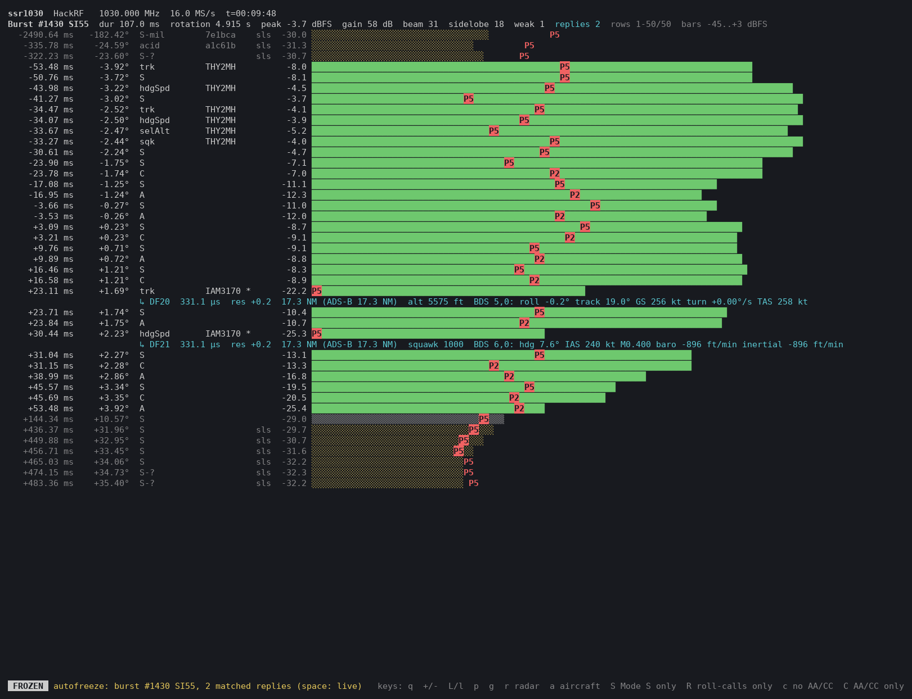

# ssr1030

Live analyser for SSR / Mode S interrogations on 1030 MHz, received with a HackRF.
It is based on [dump1030](https://github.com/Fuziih/dump1030).

## Features

- **Full Mode S uplink decoding** at 16 MS/s: UF4/5/11/20/21/24, aircraft address, II/SI code and the requested Comm-B register (BDS).
- **Mode A/C and intermode:** plain Mode A/C, A/C-only and A/C/S all-calls; P2/P5 sidelobe suppression is measured for every query.
- **Radar analysis:** main-beam bursts, rotation period, dwell time, interrogation sequence within the beam, several radars told apart by their codes.
- **Sidelobe detection:** Interrogations marked as sidelobes locally using P2/P5 pulses (note: aircraft might interprete them differently)
- **Callsigns:** from short ADS-B windows on 1090 MHz, from [adsb.lol](https://adsb.lol), or from dump1090.
- **Answered or not:** with a second 1090 MHz receiver that gives Beast output (for example dump1090 or readsb), matches 1090 MHz replies to the interrogations, marks answered ones and decodes what the aircraft replied (altitude, squawk, BDS 2,0/4,0/5,0/6,0).
- **bds_logger:** a separate small tool that reads only a Beast stream and prints the BDS 5,0 and 6,0 replies of ADS-B aircraft (track, speeds, heading, Mach, vertical rates) with callsign and AMSL altitude. No HackRF needed.
- **Live dashboard** with automatic gain, filters by radar, aircraft and interrogation type, and a burst chart. CSV log, IQ recording and replay.



*Dashboard: interrogation counts by type, Comm-B registers, radars, recent bursts and the sequence inside the beam.*



*Burst chart (`b`): every interrogation around one main-beam burst, with its level and the P2/P5 suppression pulse. Yellow bars came through the sidelobes.*

## Build

```
sudo apt install libhackrf-dev     # build header; runtime libhackrf0 is usually present
make                               # ssr1030 and bds_logger
make bds_logger                    # bds_logger only (no libhackrf needed)
```

## Run

```
./ssr1030                          # live dashboard (HackRF, 1030 MHz, 16 MS/s)
./ssr1030 -o log.csv               # + every interrogation to CSV
./ssr1030 -o log.txt --space       # + space-delimited instead
./ssr1030 -w capture.iq            # + raw IQ recording (32 MB/s) for replay
./ssr1030 -f capture.iq            # replay a recording, print summary
./ssr1030 -f capture.iq -d         # replay with the dashboard
./ssr1030 -L                       # scrolling one line per interrogation
./ssr1030 -r SI37                  # only radar SI37
./ssr1030 -r SI37 -S               # only radar SI37, Mode S interrogations only
./ssr1030 -B                       # learn callsigns from ADS-B (1090) windows (kept in memory)
./ssr1030 -r SI37 -R               # only roll-calls of SI37 (no all-calls)
./ssr1030 -C                       # only plain Mode A/C (older SSR radars)
./ssr1030 -A 48af01                # only interrogations addressed to one aircraft
./ssr1030 -A 48af01,LOT3KM,DLH123  # ... or to any of several
./ssr1030 -A LOT3KM -B             # same, by callsign
./ssr1030 --adsblol 52.23,21.01    # preload callsigns of aircraft within 150 NM from adsb.lol
```

## Filters

These apply to statistics, bursts, the log and `--list`. TCAS stays a separate statistic.

- `-r, --radar SI37|II3`: keeps one radar.
  - Mode S interrogations carry the code: UF11 has II/SI, and UF4/5/20/21 have SIS (DI=3) or IIS (DI=0/1/7).
  - IIS=0 is not proof of II0: SI-code radars send IIS=0 too, and their SI code only in UF11 and DI=3 roll-calls. So a roll-call with IIS=0 takes its burst's code, and a burst is named II0 only when IIS=0 roll-calls are all it has (for example an airport multilateration interrogator).
  - All-call interrogations are attributed through the main-beam burst they belong to.
  - A burst is named by the II/SI code sent most often by the queries inside it; on a draw an SI code wins over an II code. Plain Mode A/C is not counted.
  - With no II/SI code inside: II0 when it has roll-calls with IIS=0, else `A/C` (a plain Mode A/C radar) when it has plain Mode A/C queries, else `?` (for example only A/C-only all-calls, which come from a Mode S radar).
  - Plain Mode A/C (no P4) is never part of a burst that has a Mode S code, and is never attributed to it: a Mode S radar sends A/C-only all-calls instead, so plain A/C comes from another radar.
  - Outside bursts, an all-call is attributed if a UF11 was sent less than 300 µs before it.
  - Anything left unattributed is dropped.
  - The burst list, radar table and burst chart show only bursts with that radar's code. Another radar's burst can contain a query of the filtered radar heard in between; that query still counts in the statistics.
- `-S, --modes-only`: drops plain Mode A/C and intermode (A/C-only and A/C/S all-calls).
- `-C, --ac-only`: keeps only plain Mode A/C (tokens `AA`/`CC`, no P4), as sent by older SSR radars. It drops Mode S and all intermode all-calls (`A`/`C`, `As`/`Cs`). It cannot be combined with `-S`, `-R`, `-A` or `-c`. The key `C` toggles it at run time.
- `-c, --no-plain-ac`: drops plain Mode A/C (tokens `AA`/`CC`, no P4). Mode S and intermode all-calls stay. The key `c` toggles it at run time.
- `-I, --ii0-only`: keeps only II0 queries: UF11 with II=0, and roll-calls with IIS=0 that are not part of another radar's burst (SI radars send IIS=0 too, so inside an SI55 burst they count as SI55). Useful for interrogators such as airport multilateration. It cannot be combined with `-i`, `-C` or a radar filter other than `II0`. The key `I` toggles it at run time.
- `-i, --no-ii0`: drops those II0 queries. The key `i` toggles it at run time.
- `-R, --rollcall-only`: keeps only interrogations addressed to an aircraft (UF4/5/20/21/24/19). It drops UF11 `S`, all intermode all-calls and plain Mode A/C.
- `-A, --aircraft LIST`: keeps only interrogations addressed to the listed aircraft (UF0/4/5/16/19/20/21/24).
  - `LIST` holds up to 16 entries separated by commas, spaces or semicolons, for example `-A 48af01,LOT3KM,DLH123`.
  - Each entry is 6 hex digits or a callsign. Use `cs:` to force a callsign that looks like hex.
  - Input is case-insensitive. Output always shows hex addresses in lower case and callsigns in upper case.
  - A callsign resolves once the callsign table knows it. Until then the summary shows it as `LOT3KM(?)`.

Burst detection still uses all interrogations, because the beam is physical.
Per-burst counts, sequences, dwell and rotation are computed only from interrogations that pass the filters.

## 1090 MHz replies (`--rx1090`)

A second receiver on 1090 MHz shows which interrogations were answered. Any receiver works if it gives Beast binary output with its own 12 MHz sample timestamps: [dump1090-fa](https://github.com/flightaware/dump1090) or readsb with any SDR they support (RTL-SDR, bladeRF, a second HackRF, …), or a Mode-S Beast. The examples use dump1090-fa with an RTL-SDR; point ssr1030 at the Beast output (port 30005):

```
dump1090 --device-type rtlsdr --net --net-ro-interval 0.05 --quiet
./ssr1030 --rx1090                  # localhost:30005 is the default
./ssr1030 --rx1090 otherhost:30005  # dump1090 on another computer
```

With the radar and antenna positions, the clock locks from ADS-B positions (see **Clock** below):

```
./ssr1030 --rx1090 --radar-pos 52.1000,21.0000,150 --rx-pos 52.0900,21.0100,120
./ssr1030 --rx1090 --radar-pos RADAR --rx-pos HOME
```

The names come from `positions.csv` (in the current directory, else next to the program); `--adsblol` accepts them too. It is in `.gitignore`, so your positions stay out of the repository. One `NAME,LAT,LON[,ALT_M]` line per site, in decimal degrees and metres; lines starting with `#` are skipped, and names are not case-sensitive:

```
# name,lat,lon,alt_m
RADAR,52.1000,21.0000,150
HOME,52.0900,21.0100,120
```

Stock dump1090 drops DF4/5/20/21 replies from aircraft whose squitters (DF11 acquisition or DF17) it has not heard in the last minute. ssr1030 therefore sends every roll-called address to dump1090's Beast input (port 30004, same host) as a DF11 acquisition squitter every 20 s. dump1090 then accepts that aircraft's replies. These announced aircraft also appear in dump1090's own aircraft list.

- **Marking:** an answered query gets `*`:
  - in the recent list and `-L` output, after the `B` flag;
  - in burst sequences, for example `UF4/1*`;
  - in the burst chart, after the target.
- **Matching:**
  - roll-calls (UF4/5/20/21) by aircraft address, with a DF4/20 reply to UF4/20 and a DF5/21 reply to UF5/21;
  - UF11 by the II/SI code in the DF11 reply. II/SI codes are reused by distant radars (seen on air: SI37 DF11 replies to a radar with a ~5.0 s rotation), so with the geometry lock a DF11 reply must also arrive within 40 µs of its predicted time.
  - Delay: with an ADS-B position, only a reply at the predicted delay counts. Without one, the first matched reply sets the aircraft's delay, and for the next 60 s only replies near it count. Other radars interrogate the same aircraft, and their replies land at other delays (seen: one aircraft at 564, 798 and 1604 µs within 9 ms). Under the 1090-window clock "near" is 10 µs plus 2 µs per second since that reply (the aircraft moves), up to 250 µs; otherwise it is 250 µs.
  - Mode A/C replies carry no address or radar code, so A/C queries are never marked.
- **Clock:** the two receivers have independent clocks, and a reply must be placed to within microseconds of its query. The dashboard line `1090 replies` shows the state. Until the clock is locked, nothing is marked, and queries are held 7 s so the scans that produce the lock can still be marked; the dashboard lags by that much while searching.
  - A reply follows its query by 128 µs (transponder turnaround, counted from the sync phase reversal 4.75 µs after P1) plus the extra path radar → aircraft → receiver.
- **Sync from 1090 windows (default):** the HackRF briefly listens on 1090 MHz for 2 s (`--adsb-dwell`), placed right after a main-beam burst so no burst is lost. Its decoded ADS-B and DF11 frames carry HackRF sample times; dump1090 hears the same frames with its own sample times. Each identical frame (56 or 112 bits, good CRC) gives the clock offset directly.
  - The average of a window's frames sets the offset to ~0.1–0.3 µs rms; the change between windows is the drift (measured to ~0.01 ppm). Retuning the HackRF does not disturb its sample count, so the offset holds between windows.
  - It needs no replies, no positions and no radar: any ADS-B traffic heard by both radios works. Network delay does not matter, since both sides use sample times, so dump1090 may run on another computer.
  - Interval: between windows the offset is extrapolated with the measured drift, and the error grows as the drift itself changes (the receiver warming up, an RTL-SDR in the tests, moved it from −0.9 to −0.4 ppm in 10 minutes: 2 µs of error after 30 s, 12 µs after 2.5 min). So windows come every 30 s at first; after two windows in a row within 5 µs of the tracked clock the interval doubles, up to 5 minutes. A window more than 15 µs off, a lock loss (USB sample drop, dump1090 restart) or a window with too few frames goes back to 30 s. The dashboard shows the current interval. With `-B` the windows keep the `-B` schedule (`--adsb-every`, for callsigns) and sync the clock too.
  - Gain: during a window the HackRF uses its own gain (`--adsb-gain`, default 64 dB nominal). Automatic gain keeps the 1030 gain low when the radar is near, which leaves aircraft at 1090 in the noise; in tests decoding collapsed below 60 dB and fell again above about 75 dB.
  - A window needs 3 matching frames; with an antenna made for 1030 MHz the HackRF decodes only the stronger 1090 frames, which is why the windows are 2 s.
  - While windows keep coming, the methods below are off. After 5 minutes without a good window (no ADS-B traffic, or dump1090 timestamps missing) ssr1030 falls back to them. `--no-1090-sync` turns the windows off.
  - The windows cost 1030 MHz listening time: ~7 % while starting, under 1 % once the interval reaches 5 minutes. Sidelobe and background queries in those 2 s are missed. Bursts that touch a window are marked `*` and left out of per-burst statistics.
- **Locking from replies (fallback, or with `--no-1090-sync`):** ssr1030 finds the offset from roll-calls and replies with the same address, then tracks the drift.
  - Locking needs a few heard replies from roll-called aircraft within 60 s. With the 1090 antenna placed so that it hears few of the radar's targets, this can take a while.
  - The search looks only ±10 ms around the offset seen from the computer's clock (both streams are timestamped on arrival). The true offset has been within 1–2 ms of it in every test; the narrow search keeps chance agreements out.
  - With `--radar-pos`/`--rx-pos` (geometry lock), the predicted delays of 2 heard replies must agree within 30 µs, and they must come from 2 different scans or 2 different aircraft, or be at least 6 pairs (3 sources for the re-check to move an existing lock). In tests every false lock had exactly 2 pairs. A radar sends its roll-calls in pairs (UF4 + UF5) with fixed spacing, so replies to another radar's pair can agree by chance, but only within one scan for one aircraft. The delay histogram is then not used, because it is less reliable than waiting for this.
  - Drift: the two clocks run a few ppm apart (crystal tolerance; a receiver with a TCXO, such as the RTL-SDR Blog V4, is within 1 ppm). Each pair of matches more than 1 s apart corrects the drift (in small steps when they are close together, because each match carries a few µs of noise), and the learned drift is kept if the lock is lost. (The computer's clock is too jittery to measure the drift itself.)
  - Between rare matches the clock can wander, so the match window widens from 40 µs by 1 µs per second since the last match (up to 300 µs), and the first match after more than 30 s resets the offset.
  - Re-check: while locked, the geometry search runs every 5 s on the last minute of pairs. If no reply in that minute fits the tracked clock and another offset passes the stricter rule, ssr1030 re-locks there.
- **No `*` does not mean no reply.** The second receiver hears only some replies (antenna placement, range), so an unmarked query may have been answered.
- **Delay:** queries pass to the analysis only after their replies could have arrived, so the dashboard runs about 0.1–0.6 s behind. `--net-ro-interval 0.05` keeps dump1090's part of that small (its default is 0.5 s).
- **Replies in the burst chart (`b`):** each matched reply gets a row under its query: DF, delay after the query, residual against the position-based prediction, and the decoded content.
  - DF4/20: altitude. DF5/21: squawk. DF11: the replying aircraft's address (one row each).
  - DF20/21: also the register the query asked for: BDS 2,0 callsign; 4,0 selected altitude (MCP/FMS) and QNH; 5,0 roll, track, ground speed, turn rate, TAS; 6,0 heading, IAS, Mach, vertical rates.
  - The header shows `replies N`.
  ```
    +22.78 ms   +1.69°  UF4          RYR48SC* SI17      -16.4 ███████████████████████
                        ↳ DF4   131.6 µs  res +0.1  2.2 or 5.8 NM (ADS-B 2.3 NM)  alt 8950 ft
    +34.33 ms   +2.53°  UF5          RYR48SC* SI17      -16.9 ██████████████████████
                        ↳ DF5   131.4 µs  res -0.1  2.4 or 5.6 NM (ADS-B 2.3 NM)  squawk 6162
  ```
- **Range:** with `--radar-pos`/`--rx-pos` and a position-based lock, each reply row also shows the estimated radar→aircraft distance in NM.
  - The reply delay gives the path radar → aircraft → antenna. The query's antenna angle from the beam middle gives the aircraft's direction from the radar, and its altitude (from this reply or a recent one, or from ADS-B) gives its height. Together they fix the distance.
  - Near the radar→antenna line two distances fit; both are shown (`2.2 or 5.8 NM`). There a 1 µs timing error moves the estimate by kilometres, while elsewhere it moves it by about 150 m.
  - With no altitude known, the aircraft is assumed to be at the radar's height.
  - When dump1090 has a recent ADS-B position, its distance follows in brackets, for comparison (`(ADS-B 2.3 NM)`).
- **Autofreeze (`F`):** arms a one-shot freeze. The first burst with a matched reply freezes the screen and opens it in the burst chart; `space` returns to live, and `F` returns to live and arms it again. The status line shows `AUTOFREEZE` while armed. Without `--rx1090`, `F` only shows a hint.
- **Beep (`--beep`):** rings the terminal bell once for every burst with at least one matched reply, with or without autofreeze. This includes the burst that triggers autofreeze.
- **Callsigns:** DF17 identification and Comm-B BDS 2,0 from dump1090 fill the callsign table, so `-B` is not needed. The 1090 windows used for the clock sync also run the `-B` decoder, so its callsigns count too.
- **Debug:** `RX1090_DEBUG=1` prints each lock attempt to stderr. `RX1090_LOG=FILE` writes every reply (12 MHz time in s, DF, address, II/SI code, hex) and the clock data, for offline analysis.

## ADS-B callsigns

`-B, --adsb` retunes the HackRF to 1090 MHz for `--adsb-dwell` seconds (default 2.9) at most every `--adsb-every` seconds (default 30).

- **Timing:** once the rotation is known, a window starts right after a main-beam pass and ends before the next one, so no burst is lost. A burst that does touch a window is marked `*` and excluded from per-burst statistics.
- **Sources:**
  - DF17/18 identification (CRC must be zero).
  - DF11 replies (address presence only).
  - DF20/21 Comm-B BDS 2,0, accepted only for addresses already known.
- **Preload:** `--adsblol LAT,LON` (or a name from `positions.csv`, see **1090 MHz replies**) fills the table at startup with every aircraft within `--adsblol-radius` NM (default 150, API max 250) of that position, from the public [adsb.lol](https://api.adsb.lol) API (`/v2/lat/…/lon/…/dist/…`, via `curl`, no key needed). It sends the coordinates to adsb.lol and works with or without `-B` and in `--file` mode. If the request fails, the run continues without it.
- **Table:** kept in memory only. Optionally, `--adsb-db PATH` loads it at start and saves it after each window (for example to a file in `/tmp`). That also lets `--file` replays show callsigns.

Dashboard keys:

| Key | Action |
|---|---|
| `q` | Quit |
| `+` / `-` | VGA ±2 dB |
| `L` / `l` | LNA ±8 dB |
| `p` | RF amp on/off |
| `g` | Automatic gain on/off |
| `r` | Radar filter: type an SI code (`SI1`–`SI63`) or II code (`II0`–`II15`), then `Enter` |
| `a` | Aircraft filter: type hex addresses or callsigns (list separated by commas or spaces), then `Enter` |
| `S` | Mode S only on/off (same as `-S`) |
| `R` | Roll-calls only on/off (same as `-R`) |
| `c` | Plain Mode A/C (`AA`/`CC`) off/on (same as `-c`). Turning it off also ends `-C` |
| `C` | Plain Mode A/C only on/off (same as `-C`). Turning it on also ends `-S`, `-R`, `-c` and the aircraft filter, which would leave nothing; `S`, `R` or an aircraft filter end it |
| `i` | II0 queries off/on (same as `-i`). Turning it off also ends `-I` |
| `I` | II0 queries only on/off (same as `-I`). Turning it on also ends `-i`, `-C` and a radar filter other than `II0`; setting another radar filter ends it |
| `b` | Burst graph screen on/off (see below) |
| `space` | Freeze the screen on/off: data collection continues. On the burst chart the shown burst is pinned and stays scrollable |
| `F` | With `--rx1090`: autofreeze, freeze on the first burst with matched 1090 replies and show it in the burst chart |
| `x` | Reset statistics |

- **Manual gain:** `+ - L l p` switch the gain to manual.
- **Filter input:** `r` and `a` open an input line pre-filled with the current filter.
  - An empty line removes the filter.
  - `Esc` cancels, `Backspace` edits, `Ctrl-U` clears the line.
- **Statistics:** any filter change (`r`, `a`, `S`, `R`) resets them, so counts from different filters never mix. This also works when replaying with `-f … -d`.

Military Mode 1/2 and Mode B/D are not detected. On air they were almost all coincidences of unrelated pulses.

## Dashboard layout

Below the status lines there are three columns:
- **Interrogations:** per type, with total, in-beam, sidelobe and rate per minute (counted over the last 60 s). Mode S rows:
  - UF4 and UF5 count only plain surveillance roll-calls (answered with DF4/DF5).
  - `UF4  Comm-B req -> DF20` and `UF5  Comm-B req -> DF21` count the roll-calls that request a Comm-B register (RR ≥ 16), answered with DF20/DF21.
  - UF11 has its own row. UF19, UF20, UF21, UF24 and unknown formats share `UF other`. TCAS (UF0/UF16) is counted on its own line.
  - Always shown when non-zero: A/C-only all-calls, UF4, UF5, UF11, the two Comm-B rows, `UF other` and Mode S no sync. Other types (Mode 1/2/A/B/C/D, A/C/S all-calls, other intermode) get their own row only from 2% of all interrogations; below that they add up in `other (< 2% each)`.
  - The summary printed at exit uses the same rows.
- **Comm-B BDS:** per requested register, with register and shortcode (`4,0 selAlt`), total, in-beam, sidelobe and rate per minute.
- **Radars:** one line each with bursts, rotation, dwell and interrogations per burst. UF11 codes, DI/PC and roll-called aircraft are in the exit summary.

The three columns need about 150 terminal columns. Below them come the burst table, the last burst sequence, the interleaving table and the recent interrogations.

## Gain

**Automatic gain is on by default** (`--no-auto-gain` turns it off, `g` toggles it).
- **Target:** the strongest beam peak of all radars heard in the last 25 s is kept near −6 dBFS, whatever `-r` selects, so a strong radar never clips while a weaker one is analysed. Peaks received before a gain change are corrected to the current gain.
  - Peak ≥ −2 dBFS, or clipping: the gain goes down at once.
  - Clipping from any source in 2 consecutive 1 s windows: the gain goes down 4 dB. This happens only between beam passes, at most every 2 s.
  - The gain is never raised within 30 s of clipping, so it doesn't swing up and down.
  - Peak < −14 dBFS on two passes in a row: the gain goes up.
  - No beam pass for 10 s, or 2 rotations: the gain steps up by 4–12 dB while nothing strong is heard.
- **Timing:** changes are made only right after a beam pass, never during one. The background level is shifted by the same amount, so burst detection is not disturbed.
- **Stages:** the nominal gain (amp 11 dB + LNA + VGA) is split so that VGA stays ≥ 16 dB while LNA can move. The RF amp is used only above 80 dB, because near a radar it overloads first.
- **Manual override:** pressing `+ - L l p` switches to manual gain.
- **Starting point:** `-a/-l/-g` set the starting gain. The default is amp off, LNA 32, VGA 24.

ADS-B windows use the same gain as 1030.

The dashboard shows the HackRF settings, the mode (AUTO/MANUAL) and the last gain change with its reason.
The level check covers the last max(20 s, 3 rotations) and reports clipping, a weak signal (strongest pulse < 25 dB above noise), or OK.

Because the gain changes, `amp_dbfs` alone is not comparable over time.
The log has `gain_db` (nominal gain) and `rx_db` (= `amp_dbfs − gain_db`, a gain-independent relative level).
The burst table shows the gain each burst was received with.
If the dashboard shows `CLIPPING`, lower the gain.
Close to the radar (a few km), start with `-l 16 -g 20`.

## What it detects

| Kind | Timing from P1 |
|---|---|
| Mode A / C | P3 at 8 / 21 µs |
| A/C-only all-call (A or C) | P4 0.8 µs, 2 µs after P3 |
| A/C/S all-call (A or C) | P4 1.6 µs |
| Mode S | P2 at 2 µs, P6 at 3.5 µs, then DPSK decode of UF0/4/5/11/16/19/20/21/24 |

### Sidelobe Mode S (`--modes-threshold`)

Mode S is also decoded from pulses down to `--modes-threshold` dB above noise (default 7), below the normal pulse threshold (`--threshold`, default 12). This picks up roll-calls heard through the radar's sidelobes, aimed at aircraft in other directions.
- **Two segmenters:** a second segmenter runs at the lower threshold beside the main one. Mode A/C, intermode, S1 and the pulse-density guard use only pulses from the main one, so their results do not change. Two weak noise pulses 8 or 21 µs apart would be too common.
- **Mode S** takes a pulse from either segmenter. Near the main threshold, the main segmenter cuts weak pulses short or breaks P6 into pieces; the low one keeps them whole. In the sidelobe the sync reversal is masked by P5, so the bit timing comes from the data chips.
- **Checks:** a UF11 must decode to address `ffffff`. Any other result is a corrupted decode and is counted as `S-grb`. Roll-calls carry no such check, so a bit error gives a one-off wrong address.
- **Effect (12 s recording, 7 dB):** UF11 32 instead of 14, all with correct parity; roll-calls 50 instead of 16, 30 of them through sidelobes. Mode A/C unchanged, except 8 "A/C" that were pieces of weak Mode S.
- `--modes-threshold 12` (equal to `--threshold`) turns it off.

Each interrogation also carries these flags:
- **SLS:** P2 ≥ P1 (A/C), or P5 ≥ P6 (Mode S). Both mean a sidelobe.
- **P2 level:** P2 relative to P1, in dB.
- **S1:** a whisper-shout pulse is present.

Mode S fields decoded:
- UF4/5/20/21: PC, RR, DI, IIS/SIS, and the requested BDS (RR ≥ 16 → BDS1, RRS → BDS2).
- UF11: II/SI code and PR.
- The interrogated aircraft address.

### Address recovery

Uplink AP = parity XOR high24(A(x)·G(x)) (Gertz, MIT LL ATC-117).
So A = quotient of (parity XOR AP)·x²⁴ / G.
This was checked on air: UF11 and UF16 broadcasts decode to `ffffff`, and roll-calls decode to real ICAO addresses.

### Bit timing

Data phase reversals start at sync + 0.5 µs (N ≥ 2 chips, Annex 10 Vol IV 3.1.2.1.5.2.3), not at sync + 0.25 µs.

## Burst graph (`b`)

`b` switches the whole screen to the latest beam pass of the main radar, one row per query in time order:

```
   -262.58 ms  -19.50°  AA                               -18.5 ░░░░░░░           P2
    -36.42 ms   -2.70°  UF4b40       4a2182    SI17       -9.1 ████████████P5█████████████████
    -23.35 ms   -1.73°  A                                  1.2 ██P2█████████████████████████████████████████████████████
    +47.23 ms   +3.51°  AA                               -20.1 ▒▒▒
```

- **Scale:** fixed, from −45 dBFS (below the noise floor; `--graph-floor DB` changes it) to +3 dBFS (where I/Q clipping starts), so bar lengths compare between bursts. The header shows the gain each burst was received with.
- **Each row:** time relative to the middle of the beam pass, antenna angle from the beam middle (from the radar's rotation period, shown in the header; `-` while it is unknown), amplitude = P6 for Mode S and P1 for A/C, query token (12 characters), target (8 characters: callsign when known, else hex address), the II/SI code when the query carries one (UF11 II/SI, roll-call SIS with DI=3 or IIS with DI=0/1/7; a roll-call with IIS=0 shows `IIS0`, since SI radars send that too and it does not prove II0), `sls` for sidelobe queries, amplitude in dBFS, and a bar whose length is the amplitude.
- **Bar colour** (plain ANSI background colours; the examples here stand them in as `█` `░` `▒`):
  - green: in-beam query
  - yellow: sidelobe (SLS: P2 ≥ P1, or Mode S without sync)
  - grey: other weak query that is not SLS
- **SLS pulses:** `P2` (A/C) and `P5` (Mode S) are drawn at the column matching their level. They appear inside the bar when weaker than P1, and after the bar end when stronger, which is what suppresses the transponder.
  - The marker is always drawn at the level read at the P2 (A/C) or P5 (Mode S) slot, also when no pulse stands out of the noise: a pulse at noise level and no pulse at all give the same reading, so the chart does not tell them apart. (For the SLS flag and the statistics, a pulse still counts only from noise + 6 dB.) Mode S has no P2 to look for (it is part of the preamble).
  - A black dot on each bar marks the receiver noise floor when that query was heard: the demodulator's running average, updated every 8 ms block and smoothed over about 160 ms, so it moves with gain changes. Where the P2/P5 marker covers the same spot, the marker wins.
  - P5 is measured at the sync phase reversal. P6 flips phase there but P5 does not.
  - Across ±0.35 µs around the expected sync, the signal is fitted as a constant P5 plus a P6 that changes sign once. The best split point is the reversal, and P5 = |mean before + mean after|/2, P6 = |mean before − mean after|/2.
  - This finds the reversal even when it falls between samples, and it also works when a strong P5 masks the sync.
  - In Mode S, P2 is part of the preamble, so it is not marked.
  - P2 and P5 are read at their known positions (P2: P1 + 2.15–2.65 µs if no P2 pulse was detected; P5: the fit). They count as present at noise + 6 dB, below the normal pulse threshold.
  - A bar without a marker at the beam peak is expected. The control antenna that sends P2/P5 has a notch on boresight, so there they fall below the noise.
- **Sidelobe Mode S is decoded.** P5 ≥ P6 means a transponder would not reply (the query is not for us), but P5 covers only the sync reversal and the data chips after it are intact.
  - The bit timing is recovered within ±half a chip of the nominal sync, and the query is shown with its real type and target plus `sls`.
  - These queries carry their radar's SI/II code, so sidelobes are attributed to the radar too.
- **Time range:**
  - Sidelobes are shown from 60 % of a rotation before the pass to 60 % of a rotation after, so neighbouring passes overlap. Before the rotation is known, ±2.4 s is used.
  - Weak queries are shown only within one dwell time (30–200 ms).
  - Rows keep being added as late sidelobes arrive.
- **Scrolling:** ↑/↓ (or `j`/`k`), PgUp/PgDn, Home/End. A new burst opens just before its first beam query. `b` returns to the dashboard.
- **Filters:** the type and aircraft filters apply. Sidelobe and weak queries are hidden by `-r` only when they were attributed to a different radar.

## TCAS / ACAS

UF0, UF16 and whisper-shout (S1) interrogations are counted as a receiver health statistic.
They are left out of all radar analysis.

## Bursts (antenna main beam)

- **Background:** the median of the strongest radar interrogation in each 10 ms bin, over the last 20 s. This approximates the sidelobe level.
- **Burst:** a run of interrogations ≥ `--member-db` (3 dB) above background, with gaps < `--burst-gap` (30 ms). It must contain at least one interrogation ≥ `--core-db` (6 dB) above background.
- **Radar identity:** taken from the UF11 II/SI code in the burst, or from SIS.
- **Per radar:** rotation period (median time between burst peaks), dwell time, and interrogations per burst by query type (avg/min/max).
- **Burst table columns** (each interrogation counted once, so they add up to `n`):
  - `AA/CC`, `A/C`, `ACSall`: plain Mode A/C, A/C-only all-calls, A/C/S all-calls.
  - `UF11-all`: UF11 all-calls (token `S` in sequences).
  - `UF4`, `UF5` (`alt`, `sqk` with `-h`): UF4 and UF5 roll-calls without a Comm-B request.
  - `b20`, `b40`, `b50`, `b60` (`acid`, `selAlt`, `trk`, `hdgSpd` with `-h`): Comm-B requests for BDS 2,0, 4,0, 5,0 and 6,0, whatever the format (UF4/5/20/21).
  - `oBDS`: any other BDS.
  - `msg`: Comm-A without a request.
  - `other`: UF24, UF19 and the rest.
- **Interleaving:** the most frequent in-beam transitions, with Δt, plus the full token sequence of the last burst.
  - Tokens (`xN` = repeated N times):

| Token | Meaning |
|---|---|
| `AA` `CC` | Plain Mode A / Mode C (no P4) |
| `A` `C` | A/C-only all-call (short P4) |
| `As` `Cs` | A/C/S all-call (long P4) |
| `S` | UF11 Mode S all-call (acquisition) |
| `UF4` / `UF5` | UF4 altitude / UF5 Mode A code roll-call, no Comm-B (`alt` / `sqk` with `-h`) |
| `UF4b50` `UF5b20` `UF20b60` … | Roll-call requesting a Comm-B register: uplink format, then `b` and the BDS number (default) |
| `acid` `selAlt` `trk` `hdgSpd` | With `-h`: roll-call requesting Comm-B BDS 2,0 aircraft identification (callsign) / 4,0 selected altitude / 5,0 track and turn / 6,0 heading and speed |
| `cap` `gicb` `pos` `met` `ra` `aicb` … | With `-h`: BDS 1,0 / 1,7 / 5,1-5,2 / 4,4 / 3,0 / air-initiated; `S-bXY` = other BDS X,Y |
| `S-msg` | Comm-A UF20/21 without a Comm-B request (with `-h`, `S-msg/hdgSpd` = Comm-A also requesting BDS 6,0) |
| `S-elm` `S-mil` | UF24 ELM, UF19 |
| `S-sls` | Mode S sidelobe (P5 ≥ P6) whose bits could not be recovered. Normally sidelobe Mode S is fully decoded and shown with its own token and the SLS flag |
| `S-grb` | Mode S with no sync reversal and no P5 (garbled) |

Roll-calls carry the number of their target, for example `UF4/1` or `UF4b40/2x2` (`alt/1`, `selAlt/2x2` with `-h`).
With `-h` the burst table columns and the Comm-B BDS table also use the short names; without it they show `b20 b40 b50 b60` and the register number.
Targets are listed under the sequence, numbered in alphabetical order of their callsign or hex: `targets: 1/452124 2/DLH123`.

The interleaving statistics use the same tokens, without the target numbers.

## Log columns

`t_s utc kind uf amp_dbfs p1_dbfs p6_dbfs gain_db rx_db p2_rel_db p5_rel_db p4_us s1 sidelobe tcas burst radar addr callsign ii_si pr rr di bds sync quality hex answered reply_df reply_us replies`

- `amp_dbfs` is the query amplitude: P6 for Mode S, P1 for A/C.
  - P6 is the 70th percentile of the plateau, excluding the P5 window. It is 16–30 µs long, so much less noisy than the 0.8 µs P1.
  - `p1_dbfs` and `p6_dbfs` are both logged.
- `p2_rel_db` is P2 − P1. `p5_rel_db` is P5 − P6, so ≥ 0 means sidelobe (the transponder rule).
- `burst` is -1 outside a main-beam burst.
- `radar` is the attributed radar code, or `-` when unknown.
- `quality` is the weakest DPSK bit confidence (0–1).
- `hex` is the raw Mode S message.
- `answered reply_df reply_us replies` come from `--rx1090`:
  - `answered` is 1 when a reply was heard and 0 when none was heard. It is `-` when the query could not be checked: no `--rx1090`, clock not locked yet, or a query type that is not matched.
  - `reply_us` is the reply delay after the query in µs: 128 µs turnaround plus the extra path. It carries a small constant error from the clock lock.
  - `replies` is the number of DF11 replies for UF11, and 1 for a roll-call.

## bds_logger

A separate program: it reads a Beast stream (dump1090, readsb, …) and prints the Comm-B replies (DF20/21) that hold BDS 5,0 (track and turn) or BDS 6,0 (heading and speed), one line each. It needs no HackRF and no 1030 MHz receiver.

```
./bds_logger                       # localhost:30005
./bds_logger otherhost:30005 --qnh 1018 -v
./bds_logger --max-alt 10000          # only aircraft at or below 10000 ft pressure altitude
./bds_logger -A 48af10,LOT3TD         # only these aircraft
```

```
22:21:07.981  48e973  LOT3TD         2361 ft     BDS5,0  roll  -0.4°  track 331.9°  GS 172 kt  TAS 184 kt  turn +0.03°/s
22:21:07.988  48e973  LOT3TD         2361 ft     BDS6,0  hdg 323.1°  IAS 181 kt  M0.284  baro  -928 ft/min  inertial  -896 ft/min
```

- **Which register:** a Comm-B reply does not say which register it holds (that is in the interrogation, which a 1090 receiver does not hear), so it is inferred from the content, as in pyModeS:
  - every field whose status bit is clear must be all zeros, and values must be in range (roll within ±50°, speeds, Mach, vertical rates);
  - the aircraft must have sent ADS-B (DF17) in the last minute, and the reply must agree with its ADS-B velocity from the last 30 s: BDS 5,0 ground speed within 25 kt and track within 12°; BDS 6,0 heading within 40° of the track (wind), vertical rate within 1500 ft/min, IAS and Mach consistent with the altitude, and the true airspeed within 200 kt of the ground speed;
  - a reply that fits both registers is printed twice, once decoded as each, both marked `?` (`BDS5,0?`, `BDS6,0?`).
  - The aircraft address of a DF20/21 reply is its parity (AP) field.
- **Repeats:** an aircraft interrogated by several radars sends the same content several times; every reply is printed.
- **Altitude:** the last pressure altitude (DF20 reply, DF0/4, ADS-B), converted to AMSL with the QNH (ISA pressure-height relation).
  - `--qnh HPA` sets the QNH.
  - Otherwise it comes from BDS 4,0 replies (barometric setting) of aircraft below 4000 ft whose setting is not standard (1013.2), as the median of the last 16 within 30 minutes. Each change is noted on stderr (`# QNH 1021.0 hPa (from BDS 4,0 of …)`).
  - Until a QNH is known, the pressure altitude is shown with `STD`.
- **Time:** the receiver's 12 MHz timestamps, placed on the computer's clock, so the times are not bunched by dump1090's network batching.
- `--max-alt FT`: hides aircraft above this pressure altitude (standard 1013.25, not AMSL), and aircraft with no altitude in the last minute.
- `-A LIST`: only these aircraft, by hex address or callsign, separated by commas (`-A 48af10,LOT3TD`, case does not matter). A callsign matches once the aircraft's ADS-B identification has been heard.
- `-v`: counts every minute on stderr (Comm-B replies, unknown aircraft, BDS 5,0, BDS 6,0, above `--max-alt`, other aircraft (`-A`), ambiguous (both), neither).

## License

BSD 3-Clause, see [LICENSE](LICENSE).
The detection approach follows [dump1030](https://github.com/Fuziih/dump1030) (BSD 3-Clause, Copyright (c) 2022, Fuziih).
